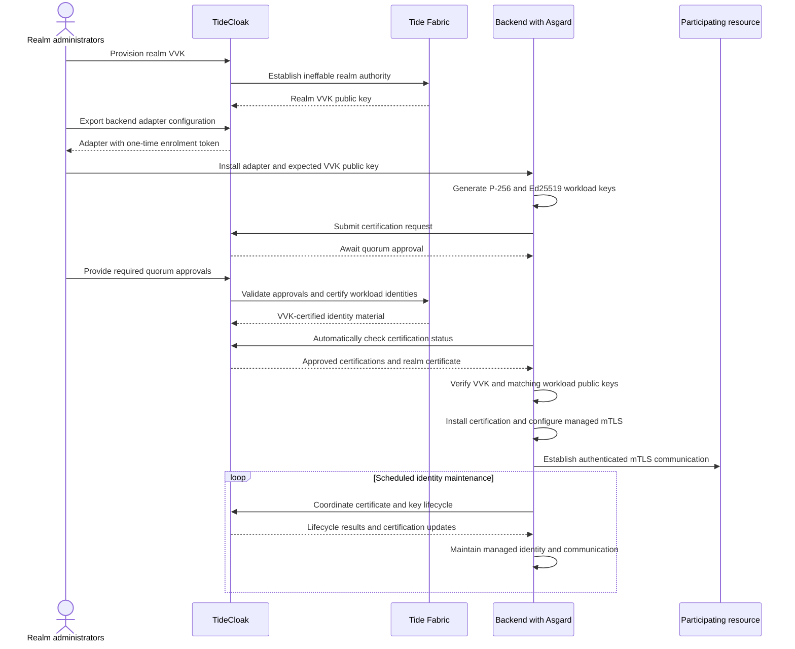
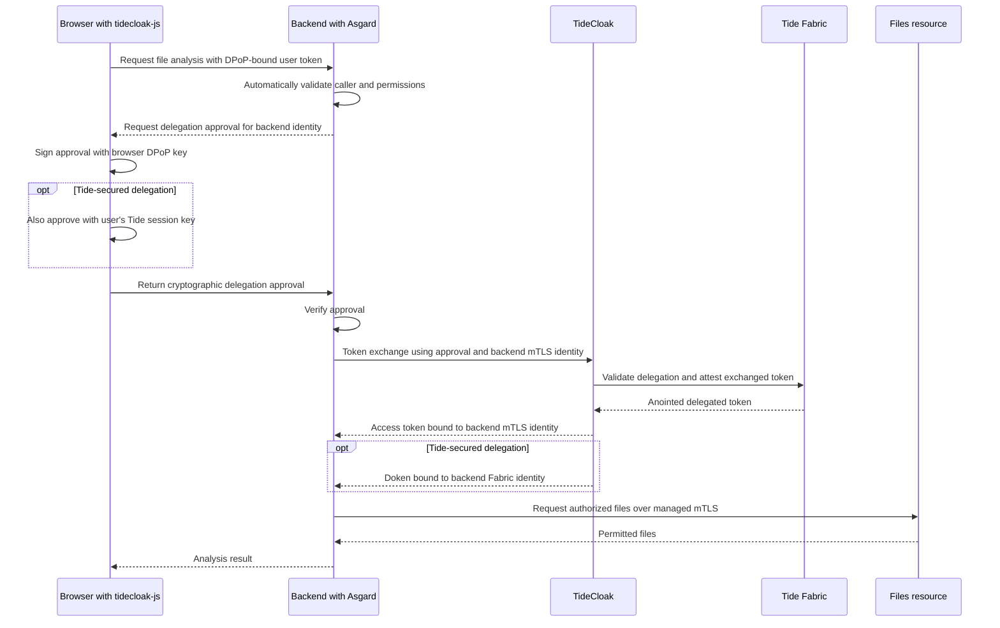
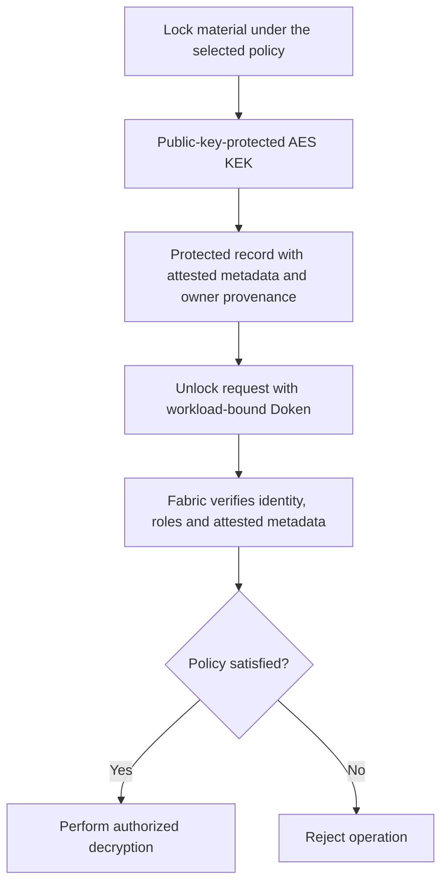

<h1 align="center">Asgard</h1>

<p align="center">
  <b>TideCloak's Cyber-Herd Immunity Server SDK</b><br/>
  Build powerful applications without giving them the keys to the kingdom.
</p>

<p align="center">
  
  
</p>

<p align="center">
  <a href="GETTING_STARTED.md">Getting started</a> ·
  <a href="aspnet/Tide.Asgard.AspNetCore/README.md">ASP.NET Core SDK</a> ·
  <a href="aspnet/Tide.Asgard.AspNetCore/Examples/Secured%20Agent/">Secured Agent Example</a>
</p>

## What is Asgard?

**Asgard is TideCloak's server-side SDK.** It brings verifiable authentication,
automatically provisioned mTLS, context-preserving delegation, and Ineffable
Cryptography to your backend through one integration.

The initial implementation is written in **C#**, supports **.NET 10**, and
integrates with **ASP.NET Core**. Python, TypeScript, PHP, Java, and additional
language variants are planned.

Your application can authenticate callers, communicate securely with other
services, act on behalf of users, and perform protected cryptographic
operations—without possessing the private authority keys behind those
operations.

## Why this changes what you can build

Most application security ultimately depends on someone protecting a powerful
secret: an IAM signing key, a CA private key, a master decryption key, or an
all-access service credential. Developers inherit both the complexity of
managing that infrastructure and the consequences when it fails.

**Tide changes the architecture, not just the strength of its defences.**

Through **Emergent Authority**, the power to certify identities, attest
permissions, and activate protected cryptographic operations remains outside
your application and its operators. That authority is exercised through
**Tide's Cybersecurity Fabric**, a decentralised network that verifies the
required identity, consent, policy, and approvals before performing an
operation. Its underlying private authority keys are never assembled or held
by any one participant.

This is more than protecting a key against extraction. The Fabric also governs
**how it is used, who can change its rules, and how those rules are evaluated**.
Moving the authority out of your backend therefore does not leave an
all-powerful administrative bypass behind.

For developers, the result is a fundamentally different starting point:
**build the capability your users need without also building a system that
holds unrestricted power over them.**

| For | What Asgard changes |
|---|---|
| **Developers** | Replace custom token-validation code, certificate workflows, delegation protocols, and Fabric orchestration with SDK integration and application policy configuration. |
| **Platform owners** | Build multi-service applications in which each backend has its own verified identity and acts within the appropriate user context—not through a shared, all-powerful credential. |
| **IT and security teams** | Govern workload admission and permissions through TideCloak while the ecosystem handles certificate provisioning, installation, use, and lifecycle maintenance automatically. |
| **Business customers** | Gain cryptographically enforced protection over identities, access, and protected data rather than relying on a platform operator's promise not to misuse unilateral authority. |

This is **Cyber-Herd Immunity** delivered as a developer tool: the security of
Fabric-protected authority no longer depends on every application component
or administrator remaining uncompromised.

**You define the application's permitted behaviour. Asgard handles the
security plumbing; the Fabric enforces the cryptographic authority behind it.**

## Getting started

Follow [GETTING_STARTED.md](GETTING_STARTED.md) and the
[ASP.NET Core SDK README](aspnet/Tide.Asgard.AspNetCore/README.md) for
installation, configuration, and working code.

### Integration sequence

1. **Prepare your TideCloak realm.** Register the participating applications
   and define their roles, permissions, and governance requirements.
2. **Provision the realm VVK.** Establish the realm's authority key through
   TideCloak and the Fabric. **VVK provisioning must be complete before
   exporting an adapter configuration.**
3. **Export and install the backend adapter configuration.** Export the
   configuration containing the one-time enrolment token, install it in
   your backend, and provision the expected realm VVK public key as its
   verification anchor.
4. **Register Asgard in your application.** Use the SDK's authentication,
   authorization, and managed communication interfaces. Declare the access
   requirements for your protected endpoints.
5. **Approve workload enrolment.** Asgard generates its identity keys and
   submits their certification request automatically. The designated
   administrators provide the required quorum approval through TideCloak;
   Asgard retrieves, verifies, installs, and employs the resulting
   certifications.

Once enrolled, the SDK manages the workload identity and certificate
lifecycle. There is no separate manual certificate-distribution or renewal
workflow to implement.

> [!IMPORTANT]
> Browser applications participating in authentication and browser-to-server
> delegation must use
> [**tidecloak-js**](https://github.com/tide-foundation/tidecloak-js).
> It provides the browser-side authentication, DPoP, delegation, and approval
> flows that work with Asgard.

Backend Fabric operations also require **direct internet access to the
Tide Fabric**, in addition to connectivity to TideCloak.

## How Asgard works

### 1. Automatic verification of Fabric-attested Tide JWTs

A **Tide JWT** is an EdDSA-signed token whose claims have been cryptographically
attested through the Fabric. Before signing—or *anointing*—the token, the
Fabric validates the identity and authorization context supporting those
claims.

Asgard verifies the resulting token **locally**, against the
**pre-installed public key of the realm's Vendor Verifiable Key (VVK)**.
That signature attests the signed claims payload, including the user's roles
and permissions.

#### A fixed verification anchor

The VVK's private authority resides ineffably in the Fabric. It is not a
private signing key stored on TideCloak, your application server, or a
single CA host.

Its public key remains the realm's **stable verification anchor**. Because
the VVK is ineffable, it does not require the private-key-exposure-driven
rotation and revocation cycle associated with centrally held authority keys.

Where common OIDC integrations obtain verification keys dynamically from
the issuer's published key set, Asgard verifies against the realm key
already provisioned in the application. Publishing a different key from
the IAM does not make that key authoritative.

#### Verification and authorization integration are built in

With the realm and client configuration installed, Asgard automatically
handles token validation, including the expected signature, issuer,
audience, and validity requirements; the applicable DPoP or mTLS sender
binding; and establishment of the authenticated caller's security context.

The SDK makes the attested roles and permissions available to the
application's authorization pipeline and applies configured endpoint
requirements.

**You declare what access an endpoint requires. You do not implement the
JWT verification, sender-proof validation, or claims-processing machinery
yourself.**

### 2. Managed, terminal-bound workload identity

Asgard gives the backend its own certified identity by generating **two
independent key pairs**:

| Workload key | Identity and use |
|---|---|
| **P-256 / ECDSA** | The certificate-based mTLS identity. The workload uses its P-256 key for ECDSA authentication when establishing secure service connections. |
| **Ed25519 / EdDSA** | The separately certified Fabric identity, used for EdDSA proofs and Doken-authorized communications with the Tide Fabric. |

Both identities are certified under the realm VVK. The mTLS certificate
contains the workload's **P-256 public key for ECDSA authentication**, while
the **VVK certifies that certificate with its EdDSA signature**. The
workload's independent Ed25519 identity serves the Fabric communication
path.

Asgard manages **generation, storage, retrieval, certification, rotation,
revocation, and recertification** of these workload keys. Scheduled
maintenance coordinates their lifecycle with the realm's TideCloak.

The current implementation uses **SDK-managed local storage on the server**.
Attested and hardware-backed identity stages are described in the
[roadmap](#supported-platforms-and-roadmap).

#### Why terminal binding matters

An access token is bound to the identity key that must prove possession
when it is used. A token copied in transit, extracted from a log, or
recovered after a session is therefore not a transferable credential:
**the token alone cannot authenticate another terminal**.

The workload keys identify the requesting backend. They do not give it
possession of the realm's private authority or the ability to issue its
own realm attestations.

### 3. mTLS that provisions and runs itself

**Asgard does not merely support certificates you have already obtained.
It automates the work required to obtain, approve, install, maintain,
and use them.**

In a manually assembled mTLS environment, teams must coordinate key
generation, certificate requests, CA signing, certificate distribution,
application wiring, and ongoing renewal. Asgard brings that workflow
inside the TideCloak ecosystem.

TideCloak manages realm membership and governance. The Fabric validates
the required approvals and certifies workload identities under the VVK.
Asgard manages the local keys and certificates and exposes the
**ready-to-use outbound mTLS interface**.

Administrators decide which workloads to admit. Developers use the
managed interface. Neither needs to hand-build the certificate
provisioning machinery.



The distinction is important: **quorum approval is a governance decision,
not a manual PKI task**. The ecosystem collects and validates that decision
as part of the automated certification workflow.

For a platform team, this turns realm-scoped mTLS from a separate
infrastructure programme into an application capability. There is no
standalone CA private key to custody for these identities, no manual
certificate installation across participating Asgard services, and no
application-specific renewal scripts to maintain.

### 4. Context-specific communication within a realm

Asgard uses the managed identities to establish **mutually authenticated,
confidential communication between participating backend services in the
same realm**.

The VVK acts as the realm's certification authority. A peer is accepted
because its identity has been certified under that realm's authority—not
merely because it is reachable on the network.

A backend can hold **multiple mTLS certificates within the same realm**,
allowing Asgard to use the certified context appropriate to a particular
session or interaction.

Two complementary bindings travel together:

| Binding | What it establishes |
|---|---|
| **mTLS identity** | Which certified workload is making the connection. |
| **Access-token context** | What that workload is authorized to do for this interaction, including any delegated user authority. |

Asgard handles the association between the selected identity, the
certificate-bound token, and the request context. A certificate from the
same realm is not interchangeable with the specific certificate to which
a token is bound.

This provides **realm membership without blanket privilege**: services
can communicate securely while retaining the permission boundaries
required by each session.

### 5. Automatic delegation from browser to backend

A backend often needs to call another service to complete a user's
request. Asgard allows it to do so **as itself, under the user's delegated
authority**.

The browser authenticates through TideCloak using `tidecloak-js` and a
**DPoP-bound token**. When a downstream operation requires delegation,
Asgard and the browser SDK automatically coordinate the user's
cryptographic approval of the backend's certified identity.

Asgard then requests a token exchange through TideCloak. The Fabric
verifies the exchange and its supporting approval before anointing a
new token, now **bound to the backend's mTLS identity**.



The backend does not forward the browser's token as though it were the
browser, and it does not need an all-access service account. It receives
authority appropriate to the originating user's security context.

For example, a file-analysis service can read the files the user is
permitted to supply for analysis without acquiring deletion rights or
access to another user's files.

The **Tide-secured delegation** path includes the additional Tide
session-key approval and supplies a **Doken** for direct Fabric
operations. This extends delegation beyond API access into protected
cryptographic operations.

From the developer's perspective, the consent coordination, proof
verification, and token-exchange protocol are handled by the SDKs.

### 6. Recursive delegation between backend services

The same model extends across multiple backend hops:

```text
Browser
  DPoP-bound user identity
    → Service A
        mTLS-bound identity + delegated user context
          → Service B
              mTLS-bound identity + delegated user context
                → Service C
```

When service B needs to call service C, Asgard obtains the applicable
**implicit consent** from the existing delegation context and executes
the next token exchange against TideCloak and the Fabric.

Service B receives authority bound to **its own identity**. It does not
reuse the token bound to service A.

At each hop, the Fabric validates the delegated authority, while Asgard
preserves the originating permission context and realm separation.
Downstream policy can further restrict that authority; adding another
service does not expand it.

This makes complex resource separation practical. An API, processing
service, file service, and cryptographic service can cooperate on one
request without sharing a universal credential or reimplementing the
delegation protocol at every boundary.

### 7. Direct Fabric access with a Tide Doken

Asgard implements Tide's Fabric request stack, allowing a backend to
perform Ineffable Cryptography operations **directly against the
decentralised Fabric network**.

It authenticates those requests with its **Tide Doken** and certified
Ed25519 workload identity.

| Credential | Purpose |
|---|---|
| **mTLS-bound access token** | Authorizes calls to TideCloak and participating backend resource APIs. |
| **Tide Doken** | Authorizes Fabric operations and is cryptographically bound to the requesting workload's Fabric identity. |

The backend can operate within its **own granted workload authority**
or within a **delegated user's authority**, depending on the operation.

The Doken carries the applicable identity and authorization context.
The Fabric validates that context against the operation's attested
metadata and policy before performing the protected action.

Asgard handles the network orchestration. Application code requests
the operation and consumes the result; it does not implement the
distributed cryptographic protocol or retrieve the underlying
ineffable private key.

### 8. Ineffable Cryptography operations

Asgard provides four principal Fabric capabilities:

| Operation | What it provides |
|---|---|
| **Encryption / locking** | Public-key encryption of an AES key-encryption key (KEK), with verifiable signature provenance for the associated metadata and owner. |
| **Decryption / unlocking** | Fabric-authorized decryption after verification of the workload's Doken identity and roles against the attested metadata governing the protected material. |
| **Signing** | Threshold attestation, approval, and activation of a signing operation, with validation of the workload's Doken and the required policy conditions. |
| **Forseti contract activation** | Execution of custom, smart-contract-like validation logic to determine whether a cryptographic operation may proceed. |

#### Protected data with verifiable ownership and policy

Locking combines protection of key material with attested metadata and
ownership. This gives subsequent decryption requests a verifiable basis
for authorization rather than relying on mutable database labels alone.



Possessing the stored ciphertext does not confer the authority to
decrypt it. That authority is established through the Fabric for the
requesting identity and context.

#### Programmable authority with Forseti

**Forseti** allows the conditions for a protected operation to go beyond
a static role check. A contract can evaluate request data, ownership,
permitted actions, and required approvals before activating an operation.

The policy logic executes through the Fabric, outside the backend's
unilateral control. Changing local application code cannot substitute
for satisfying the conditions of the Fabric-protected operation.

For example, a workflow can require both an authorized workload and a
specified set of approvals before a signing operation becomes possible.
The backend coordinates the workflow; it does not possess a signing key
that lets it skip the workflow.

See the
[Forseti engine documentation](https://docs.tide.org/Core-Concepts/forseti-engine)
for policy creation, governance, and contract activation.

## Operational boundaries—and what stays protected

Tide's security model assumes components can fail. Its advantage is that
a failure does not automatically transfer the underlying authority to
the attacker.

The following distinctions explain how that protection applies in a
running backend:

| Operational boundary | Protection retained with Asgard and the Fabric |
|---|---|
| **A compromised process can use the local workload keys available to it.** | Token-only theft remains ineffective without the corresponding key. Even control of a workload identity does not reveal the VVK or confer the ability to forge realm attestations. Fabric operations remain constrained by the workload's available grants, delegated context, and policy. |
| **Local workload keys, live tokens, and temporary symmetric material require normal host and runtime protection.** | These are not the platform's root authority keys. Their exposure does not expose an ineffable signing or decryption key, and Asgard manages their rotation, revocation, and certification lifecycle rather than leaving that work to application code. |
| **A service authorized to decrypt data can see the resulting plaintext.** | Decryption does not give the service a reusable root decryption key. Further decryptions still require the appropriate authority and attested policy context, allowing useful backend processing without granting unrestricted ownership of the protected dataset. |
| **Application code still controls its inputs, outputs, unprotected resources, and availability.** | The authority governing Fabric-protected operations is independently enforced. A local authorization bug or altered code path cannot manufacture a valid Fabric approval or bypass a Forseti condition. Application maintenance therefore complements an external cryptographic boundary rather than being its sole foundation. |

## Supported platforms and roadmap

### Server SDKs

| Language | Platform | Status |
|---|---|---|
| **C#** | .NET 10 compatible; ASP.NET Core integration | Initial implementation. See the [SDK README](aspnet/Tide.Asgard.AspNetCore/README.md). |
| **Python** | Server-side SDK | Planned. |
| **TypeScript** | Server-side SDK | Planned. |
| **PHP** | Server-side SDK | Planned. |
| **Java** | Server-side SDK | Planned. |
| **Additional languages** | Further backend integrations | Future expansion. |

### Workload identity

| Stage | Identity protection |
|---|---|
| **Current** | SDK-managed local workload keys with automatic realm certification and lifecycle management. |
| **Next** | SPIFFE/SPIRE-attested workload identity. |
| **Longer term** | Platform TPM-backed workload keys. |

## Five concepts to know

| Concept | Meaning |
|---|---|
| **Realm** | An application's security space in TideCloak: its users, clients, roles, policies, and VVK authority. |
| **Client** | An application registration in the realm. Browser clients use `tidecloak-js`; participating backends use Asgard to prove their certified workload identity. |
| **Caller** | The immediate user or service making a request. A delegated request also carries the originating user's authority context. |
| **Programmable policy** | A rule governing a protected operation, configured through the Tide ecosystem and enforced by the Fabric. |
| **Ineffable locking** | Protection of data using private cryptographic authority that remains distributed in the Fabric rather than becoming a master key held by the application. |

## Repository layout

The .NET solution lives at
[aspnet/Tide.Asgard.AspNetCore/Tide.Asgard.sln](aspnet/Tide.Asgard.AspNetCore/Tide.Asgard.sln)
and contains:

| Project | Purpose |
|---|---|
| [Tide.Asgard.AspNetCore.Authentication](aspnet/Tide.Asgard.AspNetCore/Tide.Asgard.AspNetCore/) | Main SDK: service-collection extensions, Ed25519 helpers, locking, and token exchange. |
| [Tide.Asgard.Core](aspnet/Tide.Asgard.AspNetCore/Tide.Asgard.Core/) | Cryptographic primitives, including Ed25519/EdDSA, and policy helpers. |
| [Tide.Asgard.AspNetCore.DPoP](aspnet/Tide.Asgard.AspNetCore/Tide.Asgard.AspNetCore.DPoP/) | DPoP proof-of-possession support. |
| [Tide.Asgard.AspNetCore.Example](aspnet/Tide.Asgard.AspNetCore/Tide.Asgard.AspNetCore.Example/) | End-to-end working sample. |

For another integration example, see the
[Secured Agent Example](aspnet/Tide.Asgard.AspNetCore/Examples/Secured%20Agent/).

## License

This project is dual-licensed:

- **ASP.NET Core authentication libraries**
  (`aspnet/Tide.Asgard.AspNetCore/Tide.Asgard.AspNetCore/`): Derived from the
  [Auth0 ASP.NET Core Authentication API](https://github.com/auth0/aspnetcore-api),
  which is licensed under the
  [Apache License 2.0](aspnet/Tide.Asgard.AspNetCore/Tide.Asgard.AspNetCore/LICENSE-APACHE-2.0).
  Modifications by Tide Foundation Limited are subject to both the Apache 2.0
  license (for the derived portions) and the Tide Community Open Code License
  (for new additions). See the
  [NOTICE](aspnet/Tide.Asgard.AspNetCore/Tide.Asgard.AspNetCore/NOTICE)
  file for full attribution details.
- **Core cryptography libraries**
  (`aspnet/Tide.Asgard.AspNetCore/Tide.Asgard.Core/`): Derived from
  [ScottBrady.IdentityModel](https://github.com/scottbrady91/IdentityModel),
  which is licensed under the
  [Apache License 2.0](aspnet/Tide.Asgard.AspNetCore/Tide.Asgard.Core/LICENSE-APACHE-2.0).
  Modifications by Tide Foundation Limited are subject to both the Apache 2.0
  license (for the derived portions) and the Tide Community Open Code License
  (for new additions). See the
  [NOTICE](aspnet/Tide.Asgard.AspNetCore/Tide.Asgard.Core/NOTICE)
  file for full attribution details.
