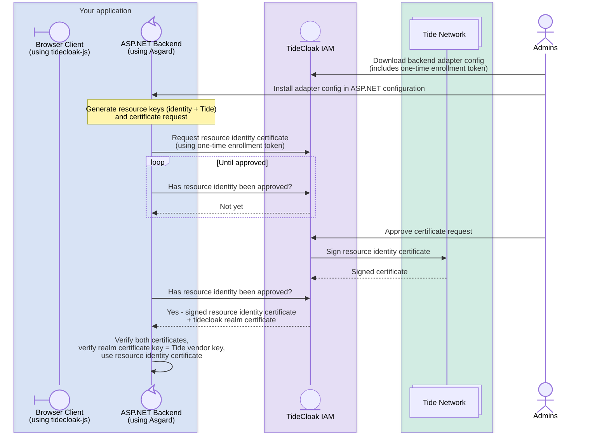
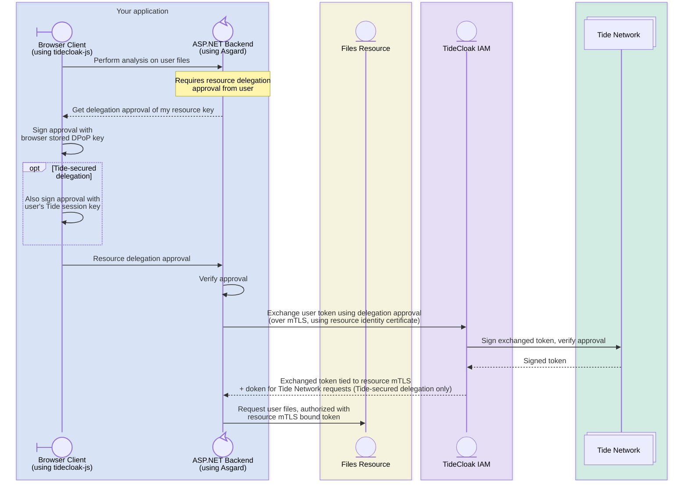
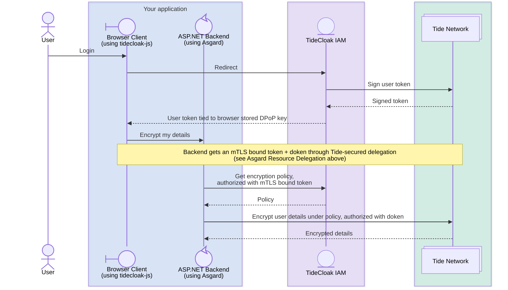

<h1 align="center">Asgard</h1>

  <b>Tide's Cyber-Herd Immunity SDK</b> 
  Authentication, authorization and authority for server apps - completely removing trust from your application.

  
  

  <a href="GETTING_STARTED.md">Getting started</a> ·
  <a href="USAGE.md">Usage</a> ·
  <a href="aspnet/Tide.Asgard.AspNetCore/Tide.Asgard.AspNetCore.Example/">Example app</a>

With Asgard, your application can verify TideCloak logins, encrypt and decrypt data without ever holding the key (**ineffable locking**), and securely exchange tokens between services.

> [!IMPORTANT]
> Asgard requires the client side library **tidecloak-js**, which handles the browser authentication and approval flows.

The fastest way to see it working end-to-end is the [Tide.Asgard.AspNetCore.Example](aspnet/Tide.Asgard.AspNetCore/Tide.Asgard.AspNetCore.Example/) project - the guides below mirror its setup.

## What Asgard adds

<table>
<tr>
<td width="33%" valign="top">

**🌐 Tide Network connectivity**

Interact with the Tide Network directly from your ASP.NET application.

</td>
<td width="33%" valign="top">

**🔒 Locking data**

Lock down sensitive application data with a key you don't hold, only accessible through your application policies.

</td>
<td width="33%" valign="top">

**🔓 Unlocking data**

Like locking the data, except your policies determine who or what has the authority to do so.

</td>
</tr>
<tr>
<td valign="top">

**📜 Policy creation**

Create programmable policies to protect your users and data with a smart-contract-like interface.

</td>
<td valign="top">

**🔁 Browser-delegated token exchange**

A user's DPoP-bound token delegates to your service, so it can act on their behalf. Only available with TideCloak.

</td>
<td valign="top">

**🔗 Service-delegated token exchange**

A service's mTLS-bound token delegates to services downstream, so they can act on its behalf. Only available with TideCloak.

</td>
</tr>
</table>

## Supported Frameworks
| Package | Framework | Language
| --- | --- | --- |
| Here | ASP.NET | C#
| Here (coming soon) | NextJS | Typescript

## How everything fits
### Asgard mTLS certificate auto-registration

### Asgard Resource Delegation

### Encryption

## 5 concepts to know

New to TideCloak? These are the only terms you need for these guides:

- **Realm** — your app's own space in TideCloak: its users, clients and policies.
- **Client** — a registration in the realm for each app that talks to TideCloak. A **public** client (e.g. your login page) runs in the browser and can't keep a secret; a **confidential** client (your backend) can prove its own identity — with Asgard, using a certificate signed by the Tide network.
- **Caller** — the logged-in user behind the current request. Their token arrives in the `Authorization` header of every call to your API.
- **Programmable policy** — a rule stored in TideCloak and enforced by the Tide network that defines who may lock or unlock what.
- **Ineffable locking** — encryption performed by the Tide network where the key never exists anywhere in full — no key material should be stored by your app.

For a deeper dive into policies and contracts, see the [Forseti engine docs](https://docs.tide.org/Core-Concepts/forseti-engine).

## Repository layout

The .NET solution lives at [aspnet/Tide.Asgard.AspNetCore/Tide.Asgard.sln](aspnet/Tide.Asgard.AspNetCore/Tide.Asgard.sln) and contains:

| Project | Purpose |
|---|---|
| [Tide.Asgard.AspNetCore.Authentication](aspnet/Tide.Asgard.AspNetCore/Tide.Asgard.AspNetCore/) | Main SDK — service-collection extensions, Ed25519 helpers, locking, token exchange |
| [Tide.Asgard.Core](aspnet/Tide.Asgard.AspNetCore/Tide.Asgard.Core/) | Cryptography primitives (Ed25519 / EdDSA), policy helpers |
| [Tide.Asgard.AspNetCore.DPoP](aspnet/Tide.Asgard.AspNetCore/Tide.Asgard.AspNetCore.DPoP/) | DPoP (proof-of-possession) support |
| [Tide.Asgard.AspNetCore.Example](aspnet/Tide.Asgard.AspNetCore/Tide.Asgard.AspNetCore.Example/) | End-to-end working sample |

## License

This project is dual-licensed:

- **ASP.NET Core authentication libraries** (`aspnet/Tide.Asgard.AspNetCore/Tide.Asgard.AspNetCore/`): Derived from the [Auth0 ASP.NET Core Authentication API](https://github.com/auth0/aspnetcore-api), which is licensed under the [Apache License 2.0](aspnet/Tide.Asgard.AspNetCore/Tide.Asgard.AspNetCore/LICENSE-APACHE-2.0). Modifications by Tide Foundation Limited are subject to both the Apache 2.0 license (for the derived portions) and the Tide Community Open Code License (for new additions). See the [NOTICE](aspnet/Tide.Asgard.AspNetCore/Tide.Asgard.AspNetCore/NOTICE) file for full attribution details.
- **Core cryptography libraries** (`aspnet/Tide.Asgard.AspNetCore/Tide.Asgard.Core/`): Derived from [ScottBrady.IdentityModel](https://github.com/scottbrady91/IdentityModel), which is licensed under the [Apache License 2.0](aspnet/Tide.Asgard.AspNetCore/Tide.Asgard.Core/LICENSE-APACHE-2.0). Modifications by Tide Foundation Limited are subject to both the Apache 2.0 license (for the derived portions) and the Tide Community Open Code License (for new additions). See the [NOTICE](aspnet/Tide.Asgard.AspNetCore/Tide.Asgard.Core/NOTICE) file for full attribution details.
