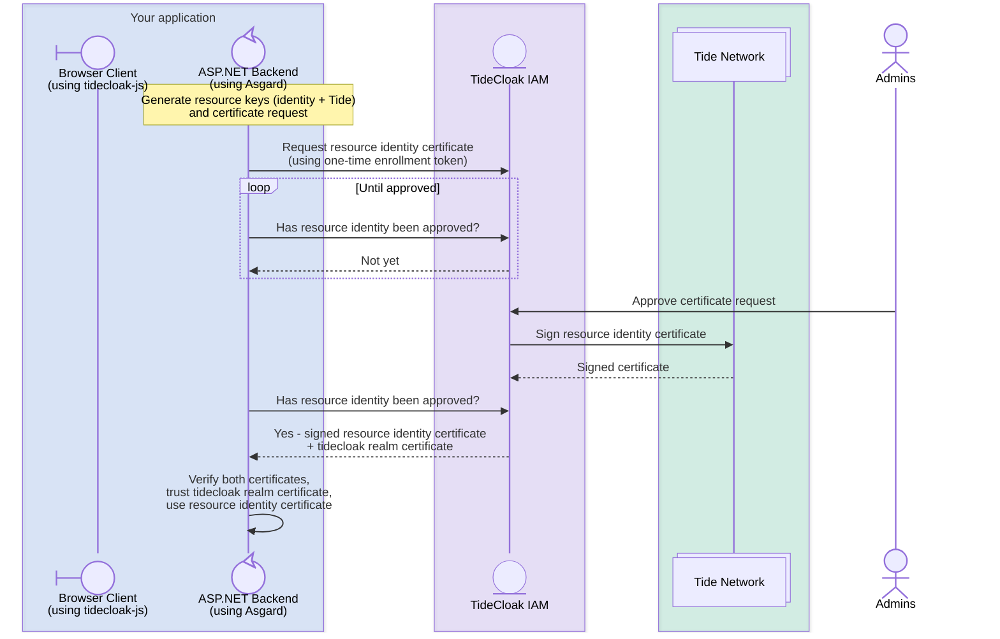
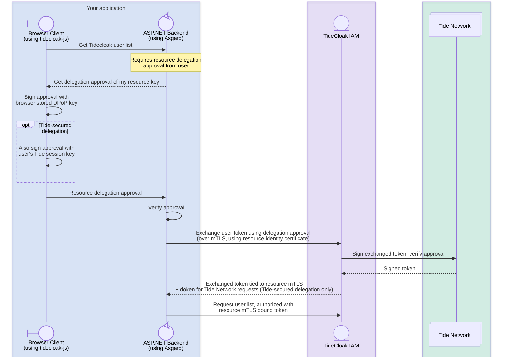
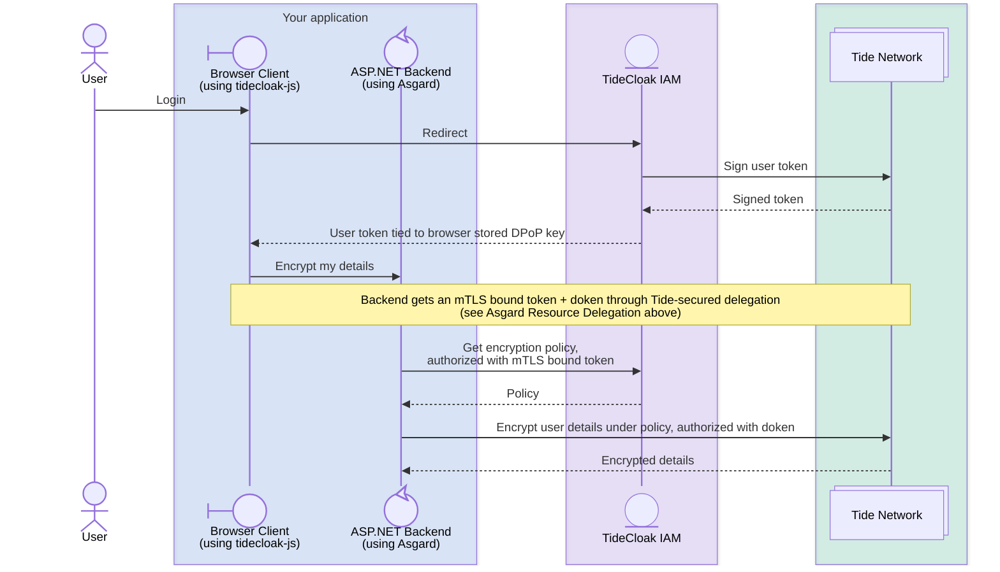

# Asgard

Asgard is a .NET **Cyber Immunity SDK**; authentication, authorization and authority for ASP.NET Core apps - built for **TideCloak**. With Asgard, your ASP.NET application can verify TideCloak logins, perform **ineffable locking** (encryption) of data under programmable policies, and securely exchange tokens between services.

Asgard requires the client side library **tidecloak-js**, which handles the browser authentication and approval flows.

The fastest way to see it working end-to-end is the [Tide.Asgard.AspNetCore.Example](aspnet/Tide.Asgard.AspNetCore/Tide.Asgard.AspNetCore.Example/) project - the snippets below mirror its setup.

## Guides to get into it
| Guide | Used for
| --- | --- |
| [USAGE](USAGE.md) | Using Asgard for user authentication, decentralized locking operations and policy management.
| GETTING STARTED | Integrating Asgard into a new ASP.NET project
| MIGRATION | Replacing another ASP.NET Authentication Provider with Asgard
| EXTENSION | Extending core Asgard functions such as the AsgardCache

## Seeing it from above
### Asgard mTLS certificate auto-registration

### Asgard Resource Delegation

### Encryption



## 5 concepts to know

New to TideCloak? These are the only terms you need for these guides:

- **Realm** — your app's own space in TideCloak: its users, clients and policies.
- **Client** — a registration in the realm for each app that talks to TideCloak. A **public** client (e.g. your login page) runs in the browser and can't keep a secret; a **confidential** client (your backend) can prove its own identity — with Asgard, using a certificate signed by the Tide network.
- **Caller** — the logged-in user behind the current request. Their token arrives in the `Authorization` header of every call to your API.
- **Programmable policy** — a rule stored in TideCloak and enforced by the Tide network that defines who may lock or unlock what.
- **Ineffable locking** — encryption performed by the Tide network where the key never exists anywhere in full — no key material should be stored by your app.

For a deeper dive into policies and contracts, see the [Forseti engine docs](https://docs.tide.org/Core-Concepts/forseti-engine).

## Prerequisites

- .NET 10 SDK
- A running TideCloak instance with a configured realm and licence
- Two clients in that realm:
  - a **public client** for the browser-side login page (e.g. `browser-login-page`)
  - a **confidential client** for your .NET backend (e.g. `backend`), with its client authenticator set to `tide-mtls` and standard token exchange enabled

Give the public client an **audience mapper** targeting the backend client — it stamps the backend's name into every login token, which is what makes your backend accept tokens from your login page.

## 1. Add the adapter config to your app

Every TideCloak client exposes an **adapter config** — a small JSON blob that tells an SDK how to reach your realm and authenticate as that client. Asgard reads the backend client's adapter config from `appsettings.json`.

**Download it** from the Admin UI — in your realm -> Clients -> `backend` -> top-right **Action** dropdown -> **Download adapter config** — or fetch it via the API.

**Paste it into `appsettings.json`** under a section named `Keycloak`:

```json
{
  "Keycloak": {
    "realm": "test",
    "auth-server-url": "http://localhost:8080",
    "ssl-required": "external",
    "resource": "backend",
    "vendorId": "...",
    "enrollment_token": "<one-time enrollment token>",
    "jwk": {
      "keys": [
        {
          "kid": "...",
          "kty": "OKP",
          "alg": "EdDSA",
          "use": "sig",
          "crv": "Ed25519",
          "x": "..."
        }
      ]
    }
  }
}
```

The downloaded file carries more Tide fields than shown here — paste it whole. There is no client secret: the `enrollment_token` lets your backend request its own certificate the first time it starts (step 2).

> **Why "Keycloak"?** TideCloak is built on Keycloak, and Asgard builds on the `Keycloak.AuthServices` library — which reads its configuration from this section. That's the only reason the name appears here and in a few APIs below.

> If you're also using `@tidecloak/js` on the browser side, download its adapter config separately and follow its instructions for installing it.

## 2. Register authentication and Asgard

TideCloak signs tokens with EdDSA (Ed25519), a modern signature scheme .NET can't validate natively. Asgard's `GetEd25519IssuerKey()` reads the signing key from your adapter config so standard token validation can use it.

`Program.cs`:

```csharp
using Keycloak.AuthServices.Authentication;
using Tide.Asgard.AspNetCore.Authentication;
using Tide.Asgard.AspNetCore.Authentication.TokenExchange;

var builder = WebApplication.CreateBuilder(args);

builder.Services.AddControllers();

// Validate TideCloak-issued EdDSA tokens
builder.Services
    .AddKeycloakWebApiAuthentication(builder.Configuration, options =>
    {
        options.RequireHttpsMetadata = false; // local dev only
        options.TokenValidationParameters.IssuerSigningKey = builder.Configuration.GetEd25519IssuerKey();
    });

// Ineffable locking, policies and token exchange
builder.Services.AddAsgard(builder.Configuration, ResourceAuthenticationMode.AutoMTLSEnrollment);
builder.Services.AddProblemDetails(); // required by app.UseExceptionHandler()

var app = builder.Build();

app.UseExceptionHandler(); // required — Asgard registers an exception handler that relies on it

app.UseAuthentication();
app.UseAuthorization();

app.MapControllers();

app.Run();
```

`AddAsgard` registers everything the [usage guide](USAGE.md) builds on: `IAspAsgardService` for locking, a policy provider backed by TideCloak, the token exchange service, and an exception handler that translates Asgard errors into `Asgard-*` response headers (which is why `app.UseExceptionHandler()` is required).

`ResourceAuthenticationMode.AutoMTLSEnrollment` tells Asgard to request its own certificate from TideCloak on first start, using the enrollment token from step 1. An admin has to approve that request in TideCloak; Asgard keeps checking (every minute by default) and picks the certificate up without a restart — the flow is drawn in [Asgard mTLS certificate auto-registration](#asgard-mtls-certificate-auto-registration). Use `ResourceAuthenticationMode.MTLS` instead when the certificate is already in place and no enrollment should happen.

## 3. Enable DPoP

DPoP is an additional layer of security that ensures access tokens can't be stolen: it cryptographically ties the caller's token to their browser, rendering a stolen token useless anywhere else.

It is optional if you only verify logins, but locking, policy management and token exchange all require it.

To enable it, add `.WithDPoP` to the authentication registration from step 2:

```csharp
using Tide.Asgard.AspNetCore.DPoP;

builder.Services
    .AddKeycloakWebApiAuthentication(builder.Configuration, options =>
    {
        options.RequireHttpsMetadata = false;
        options.TokenValidationParameters.IssuerSigningKey = builder.Configuration.GetEd25519IssuerKey();
    })
    .WithDPoP(opts =>
    {
        opts.Mode = DPoPModes.Required;
    });
```

Every API protected by this authentication scheme will now require a valid DPoP proof.

Then serve Tide's DPoP confirmation page, which the Tide login uses to check that the browser really holds its DPoP key. Pass the id of your **public** client, and place the call before `app.UseAuthentication()`:

```csharp
app.UseTideSecuredDPoP(builder.Configuration, "browser-login-page");
```

## Next: use it

Setup is done. The [usage guide](USAGE.md) covers what comes next: protecting endpoints, locking data with a policy, managing policies and exchanging tokens.

## Repository layout

The .NET solution lives at [aspnet/Tide.Asgard.AspNetCore/Tide.Asgard.sln](aspnet/Tide.Asgard.AspNetCore/Tide.Asgard.sln) and contains:

| Project | Purpose |
|---|---|
| [Tide.Asgard.AspNetCore.Authentication](aspnet/Tide.Asgard.AspNetCore/Tide.Asgard.AspNetCore/) | Main SDK — service-collection extensions, Ed25519 helpers, locking, token exchange |
| [Tide.Asgard.Core](aspnet/Tide.Asgard.AspNetCore/Tide.Asgard.Core/) | Cryptography primitives (Ed25519 / EdDSA), policy helpers |
| [Tide.Asgard.AspNetCore.DPoP](aspnet/Tide.Asgard.AspNetCore/Tide.Asgard.AspNetCore.DPoP/) | DPoP (proof-of-possession) support |
| [Tide.Asgard.AspNetCore.Example](aspnet/Tide.Asgard.AspNetCore/Tide.Asgard.AspNetCore.Example/) | End-to-end working sample |

The SDK is currently consumed via `<ProjectReference>` — see [Tide.Asgard.AspNetCore.Example.csproj](aspnet/Tide.Asgard.AspNetCore/Tide.Asgard.AspNetCore.Example/Tide.Asgard.AspNetCore.Example.csproj) for the wiring.


## License

This project is dual-licensed:

- **ASP.NET Core authentication libraries** (`aspnet/Tide.Asgard.AspNetCore/Tide.Asgard.AspNetCore/`): Derived from the [Auth0 ASP.NET Core Authentication API](https://github.com/auth0/aspnetcore-api), which is licensed under the [Apache License 2.0](aspnet/Tide.Asgard.AspNetCore/Tide.Asgard.AspNetCore/LICENSE-APACHE-2.0). Modifications by Tide Foundation Limited are subject to both the Apache 2.0 license (for the derived portions) and the Tide Community Open Code License (for new additions). See the [NOTICE](aspnet/Tide.Asgard.AspNetCore/Tide.Asgard.AspNetCore/NOTICE) file for full attribution details.
- **Core cryptography libraries** (`aspnet/Tide.Asgard.AspNetCore/Tide.Asgard.Core/`): Derived from [ScottBrady.IdentityModel](https://github.com/scottbrady91/IdentityModel), which is licensed under the [Apache License 2.0](aspnet/Tide.Asgard.AspNetCore/Tide.Asgard.Core/LICENSE-APACHE-2.0). Modifications by Tide Foundation Limited are subject to both the Apache 2.0 license (for the derived portions) and the Tide Community Open Code License (for new additions). See the [NOTICE](aspnet/Tide.Asgard.AspNetCore/Tide.Asgard.Core/NOTICE) file for full attribution details.
